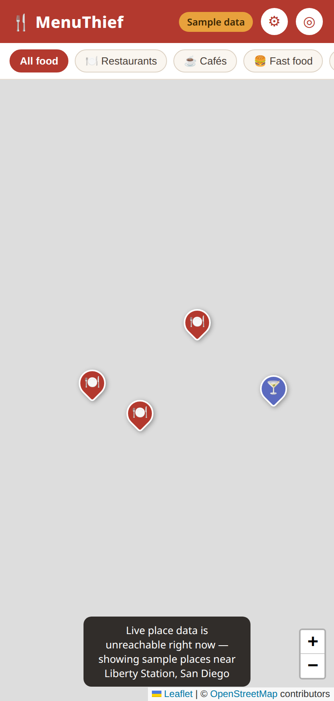
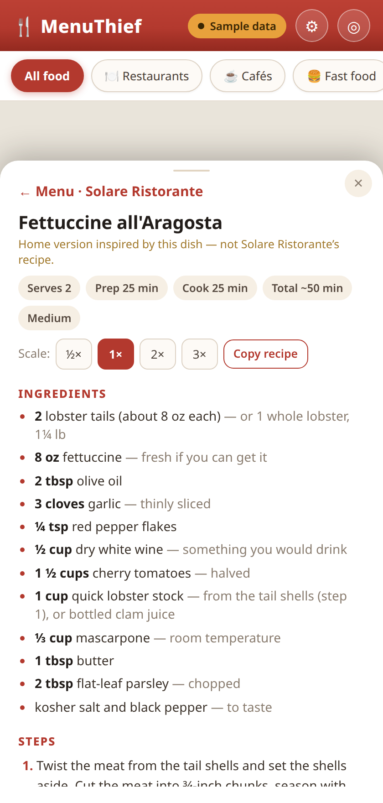

# 🍴 MenuThief

**See the menu, cook the dish.**

A food-only map: every pin is somewhere to eat. Tap a place to see its
*actual* menu; tap a dish to get a home-cook version of it.

## Download

- **Android app:** [`menuthief.apk`](https://github.com/Bobbywasabi31/menuthief/raw/main/menuthief.apk)
  — right in this repo (4.2 MB, debug-signed preview build; Android will
  ask you to allow the install). Also attached to every
  [release](https://github.com/Bobbywasabi31/menuthief/releases).
- **Web version:** `menuthief.html` on the
  [latest release](https://github.com/Bobbywasabi31/menuthief/releases/latest)
  — one self-contained file, open it in any browser.




## How it works

1. **Map** — food places from OpenStreetMap via the Overpass API
   (restaurants, cafés, fast food, bakeries, bars & pubs, dessert),
   filtered by category. No Google Places: its API doesn't return menu
   items anyway.
2. **Menu** — tapping a place runs the menu pipeline in the browser:
   find the menu link on the restaurant's *own* site (delivery platforms
   are excluded as a rule), fetch the page, structure it into a strict
   schema with an LLM, validate, and cache it on-device. Every menu
   carries provenance: source URL + fetch date.
3. **Recipe** — tapping a dish generates a home version of it, always
   labeled *inspired by* the dish — never claimed to be the restaurant's
   own recipe. Servings scale ½×–3×; recipes cache per place + dish.

If live place data is unreachable, the app falls back to a small set of
sample places around Liberty Station, San Diego — visibly labeled
"Sample data", never faked as live. Two sample menus and two sample
recipes are bundled (Solare Ristorante, Starlite), including an honest
no-menu case (Sushi Tadokoro, which publishes none).

## Bring your own key

Structuring menus and writing recipes uses an OpenAI-compatible chat
endpoint with **your** key (⚙ in the app). The key is stored only in
your browser's localStorage and sent only to your provider. Point the
endpoint at a local Ollama (`http://localhost:11434/v1`) and no key is
needed at all.

Known limits: PDF menus are detected but not parsed in the browser yet;
JS-rendered chain menus (e.g. In-N-Out) need a headless-render fallback
that is designed but parked.

## Develop

```sh
npm install
npm run dev      # dev server
npm run build    # single-file build -> dist/index.html
```

The build is one self-contained HTML file (all JS/CSS inlined) — open it
in any browser, host it anywhere static.

## Android app

The same web build also ships as a real Android app: a thin
[Capacitor](https://capacitorjs.com) shell (`android/`, app id
`com.menuthief.app`) that wraps the single-file build in a WebView — one
codebase, no fork. CI builds a debug-signed APK on every push
(`assembleDebug`); releases attach it as `menuthief.apk`.

```sh
npm run build
npx cap sync android   # copies dist/ into the shell
cd android && ./gradlew assembleDebug
```

Location permission is declared for the app's "center on me" button
(HTML5 geolocation in the WebView). The API key stays in the WebView's
local storage, same as the browser version.

## Test

```sh
node test-places.mjs    # data-layer logic (Overpass query, fallback)
node test-menus.mjs     # menu pipeline logic (link ranking, validator)
node test-recipes.mjs   # recipe validator, quantity scaling
node smoke.mjs          # headless-Chrome UI tests (needs puppeteer)
node smoke2.mjs         # M2: menus in the place card
node smoke3.mjs         # M3: tap-a-dish recipes
```

CI runs the logic tests and the production build on every push.

## Layout

- `src/` — the app (React + Leaflet, plain CSS, no component library)
  - `places.js` — Overpass data layer + sample fallback
  - `menus.js` — in-browser port of the menu pipeline (discovery,
    the M0 extraction prompt, the schema validator, BYOK structuring)
  - `recipes.js` — recipe prompt, validator, scaling, cache
- `m0/` — the original Python menu-pipeline prototype and its graded
  test run over 6 San Diego restaurants (173 dishes structured, one
  honest refusal, one known failure). Its outputs are the bundled
  sample menus. See `m0/RESULTS.md`.
- `docs/PLAN.md` — the full product/engineering plan, including the
  milestone history (M0–M3) and the naming decision.
